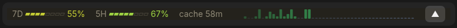
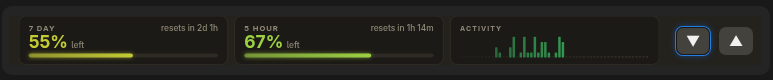
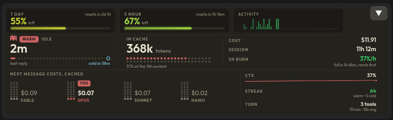

# rMods

Two mods for Claude Code: **mod-curator** and **ribbon-plus**. Install steps are at the end.

## mod-curator

`/mods` opens a pane listing your installed plugins. Each one has buttons to turn it on or off, or to remove it (Remove asks for a second press first). Refresh re-reads the list. Changes apply after `/reload-plugins`.

## ribbon-plus

A fork of [ribbon](https://github.com/robonuggets/ribbon) (MIT). A usage band above the prompt that shows how much of your 7-day and 5-hour usage is left, with bars that run from green to red as a window drains. It comes in three sizes. The arrows on the right move between them, `/ribbon-plus` cycles through them, and the size you pick is remembered.

**Small:** one row with bars for each window, the cache countdown and an activity strip.



**Medium:** a card for each window with the percent left, a bar and the reset time, plus a card of recent activity.



**Large:** the cards over a full-width panel with the prompt cache, what the next message costs on each model, and the session's cost, length, burn rate, context fill, warm streak and turn pace.



More detail is in [its README](plugins/ribbon-plus/README.md).

## Install

At the prompt of a terminal session:

```
/plugin install mod-curator --marketplace allisonhere/rMods
/plugin install ribbon-plus --marketplace allisonhere/rMods
```

From a shell:

```
claude plugin install mod-curator --marketplace allisonhere/rMods
claude plugin install ribbon-plus --marketplace allisonhere/rMods
```

In the desktop app, where `/plugin` does not run: click + next to the prompt box, then Plugins, Add marketplace with `allisonhere/rMods`, then Add plugin.

If you already use the original ribbon, turn it off first (`/mods` does that) so two bands don't show.

ribbon-plus keeps the original's MIT license; see `plugins/ribbon-plus/LICENSE`.
